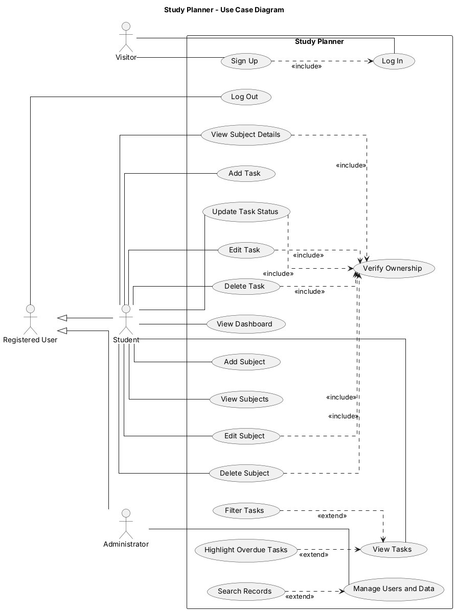
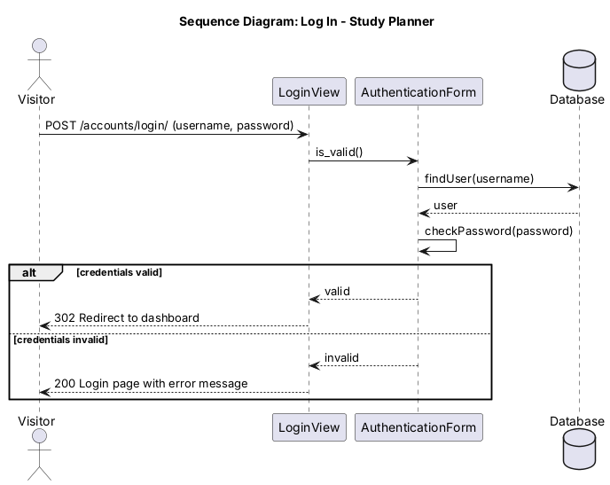
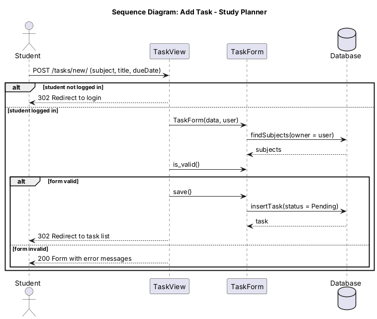
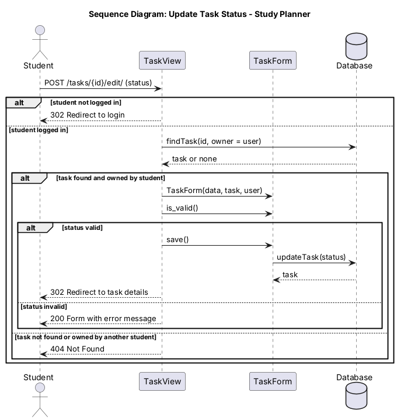
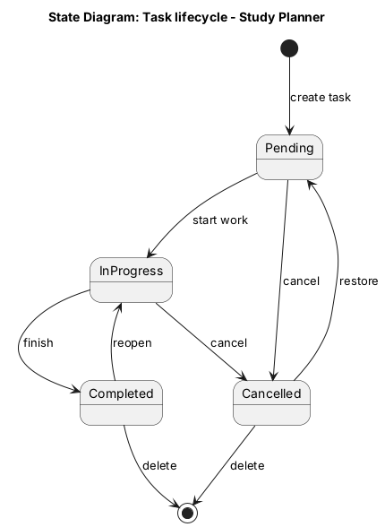

# Design: Study Planner

Diagrams are written as code with PlantUML (`.puml`) and exported as PNG, so they can be reviewed in pull requests like any other file.

## Structure (Lab 3)

| Diagram | Source | Image |
|---|---|---|
| Use Case Diagram | [use_case_diagram.puml](use_case_diagram.puml) |  |
| Class Diagram | [class_diagram.puml](class_diagram.puml) |  |

## Behaviour (Lab 4)

| Diagram | Source | Image |
|---|---|---|
| Sequence: Log In | [sequence_log_in.puml](sequence_log_in.puml) |  |
| Sequence: Add Task | [sequence_add_task.puml](sequence_add_task.puml) |  |
| Sequence: Update Task Status | [sequence_update_task_status.puml](sequence_update_task_status.puml) |  |
| State: Task lifecycle | [state_task.puml](state_task.puml) |  |

To re-render after editing: `java -jar plantuml.jar -tpng docs/design/*.puml`, or use the PlantUML extension in VS Code.

## Traceability: Must stories to diagrams

| Story | Use case | Sequence diagram |
|---|---|---|
| US-01 Create an account | Sign Up | (Sign Up includes Log In) |
| US-02 Log in | Log In | Log In |
| US-03 Log out | Log Out | - |
| US-04 Add a subject | Add Subject | - |
| US-05 View subjects | View Subjects | - |
| US-08 Add a task | Add Task | Add Task |
| US-09 View tasks by due date | View Tasks | - |
| US-10 Change task status | Update Task Status | Update Task Status, State: Task lifecycle |
| US-15 Private data | Verify Ownership | Update Task Status (404 branch) |

Other stories: US-06 Edit Subject, US-07 Delete Subject, US-11 Edit Task, US-12 Delete Task, US-13 View Dashboard, US-14 View Subject Details, US-16 Filter Tasks (extend), US-17 Highlight Overdue Tasks (extend), US-18 Manage Users and Data, US-19 Search Records (extend).

## Notes on the models

- `Student` owns `Subject` (1 to 0..*), and `Subject` contains `Task` (composition): deleting a subject deletes its tasks, as in the Django model (`on_delete=CASCADE`).
- `TaskStatus` has the four values of the model: Pending, In Progress, Completed, Cancelled.
- `isOverdue()` supports US-17 and is not implemented yet. "Overdue" is not a stored status; it is derived from the due date, so it is not a state in the state diagram.
- In the sequence diagrams, `TaskView`, `LoginView` and `TaskForm` are the Django view and form classes (`planner/views.py`, `planner/forms.py`). A successful form submit answers with a 302 redirect, and an invalid form is shown again with a 200 and error messages.
- The state diagram shows the intended lifecycle. The current form lets a student pick any status from the list, so these transitions are not yet enforced in code.
