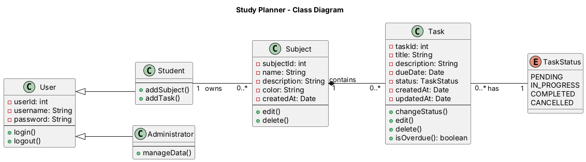

# Design: Study Planner

Diagrams are written as code with PlantUML (`.puml`) and exported as PNG, so they can be reviewed in pull requests like any other file.

| Diagram | Source | Image |
|---|---|---|
| Use Case Diagram | [use_case_diagram.puml](use_case_diagram.puml) |  |
| Class Diagram | [class_diagram.puml](class_diagram.puml) |  |

To re-render after editing: `java -jar plantuml.jar -tpng docs/design/*.puml`, or use the PlantUML extension in VS Code.

## Traceability: Must stories to use cases

| Story | Use case |
|---|---|
| US-01 Create an account | Sign Up |
| US-02 Log in | Log In |
| US-03 Log out | Log Out |
| US-04 Add a subject | Add Subject |
| US-05 View subjects | View Subjects |
| US-08 Add a task | Add Task |
| US-09 View tasks by due date | View Tasks |
| US-10 Change task status | Update Task Status |
| US-15 Private data | Verify Ownership (included by every use case that opens a single subject or task) |

Other stories: US-06 Edit Subject, US-07 Delete Subject, US-11 Edit Task, US-12 Delete Task, US-13 View Dashboard, US-14 View Subject Details, US-16 Filter Tasks (extend), US-17 Highlight Overdue Tasks (extend), US-18 Manage Users and Data, US-19 Search Records (extend).

## Notes on the models

- `Student` owns `Subject` (1 to 0..*), and `Subject` contains `Task` (composition): deleting a subject deletes its tasks, as in the Django model (`on_delete=CASCADE`).
- `TaskStatus` has the four values of the model: Pending, In Progress, Completed, Cancelled.
- `isOverdue()` supports US-17 and is not implemented yet.
