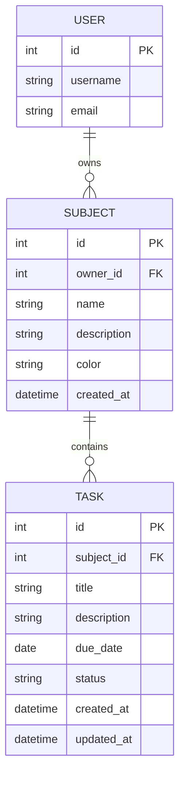
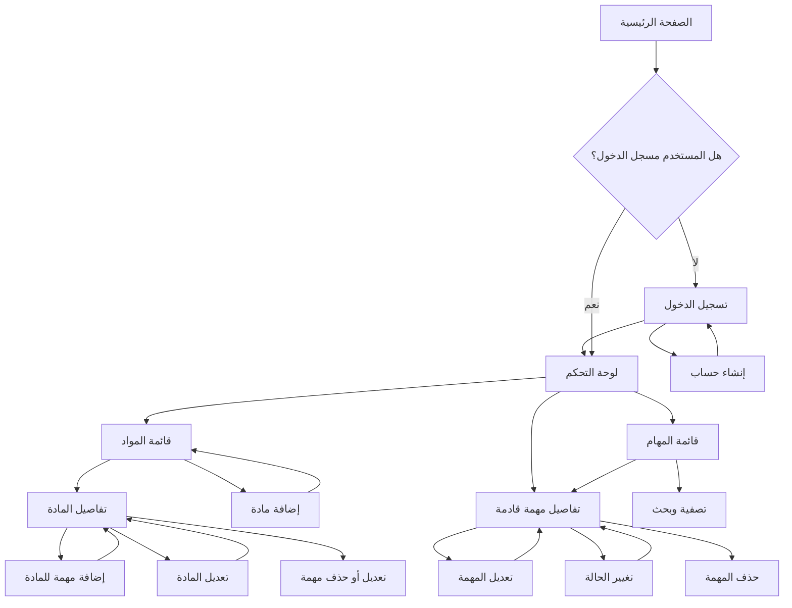
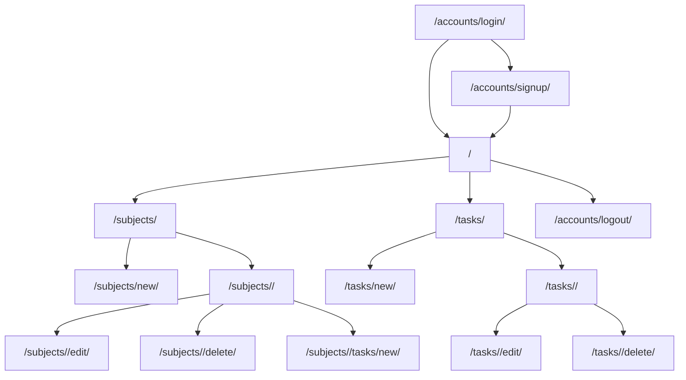
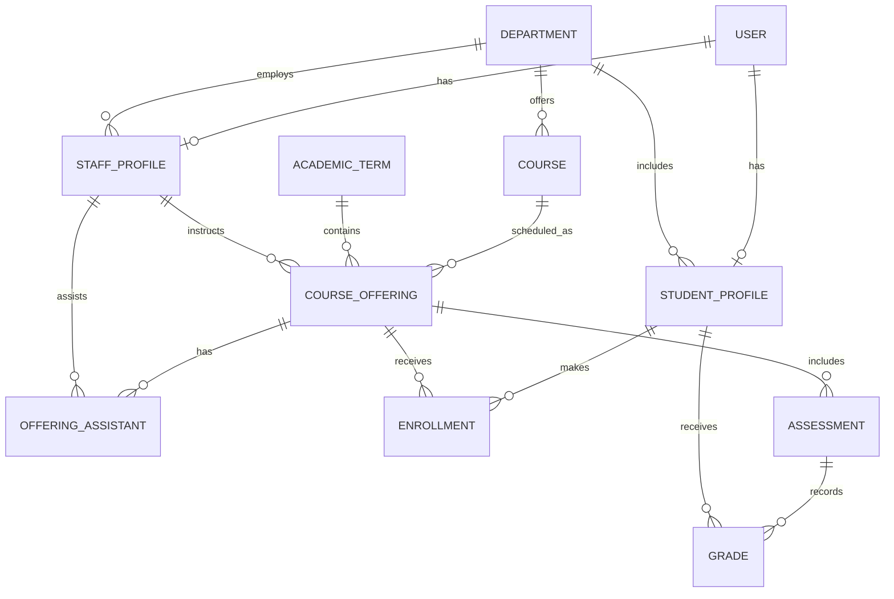
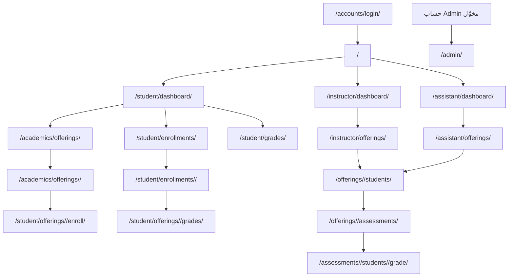

# توضيح استخدام SQL بدل shell

> أنا فاهم حتة الموديلز تمام، بس حتة إن أنا أعمل insert أو update أو delete أو select للـdata بفضل أستخدم SQL. هل ينفع أستخدم SQL بدل shell وobject to tool والكلام ده كله؟ ولا مش ينفع.
>
> User context
>
> Images:
> - `~/AppData/Local/Temp/codex-clipboard-fa35e0b3-d2e9-427e-89af-fefa2ad33339.png`

أيوه، ينفع تكتب SQL مباشرةً للتعامل مع البيانات، لكن الصورة بتعرض طريقة Django المعتادة عبر **الـORM**: بدل ما تكتب SQL، تستورد موديل `Flight` وتطلب منه البيانات بكود Python.

مثلًا، هذين الاستعلامين متقاربان في المعنى:

```python
Flight.objects.all()
```

```sql
SELECT * FROM flights_flight;
```

وفي Django، تقدر تستخدم الـORM للإضافة والتعديل والحذف والاستعلام، أو تنفّذ SQL مباشرةً عند الحاجة عبر `connection.cursor()` أو `Model.objects.raw()`.

غالبًا الـORM أريح داخل التطبيق لأنه يتعامل مع ربط النتائج بالموديلات ويقلل اختلافات SQL بين قواعد البيانات. والـSQL المباشر مفيد للاستعلامات المعقدة أو عند الحاجة لتحكم أدق. وعادةً لا تكتب أوامر SQL داخل الـshell مباشرةً؛ تكتبها من خلال واجهة Django التي تنفّذها على قاعدة البيانات.

> طيب عادي أستخدم SQL وأستغنى عن الموديلز وكل ما له علاقة بالـdatabase وأعوضه باستخدام SQL، ولا أستخدم موديلز وأعمله register في admin وأستخدم SQL بحيث مثلاً عايز أحط داتا أو أخد داتا. إيه الصح.

تقدر تستخدم SQL مباشرةً من غير ما تكتب موديلز، لكن في مشروع Django المعتاد الأفضل **تعرّف موديلز** وتستخدمها للتعامل مع البيانات. الـORM يحوّل أوامرك لاستعلامات SQL وينفّذها على قاعدة البيانات؛ يعني استخدام الموديلز لا يعني إنك استغنيت عن SQL، بل إن Django يكتبه وينفّذه عنك.

مثلًا:

```python
Flight.objects.all()  # استعلام بيانات
Flight.objects.create(origin="New York", destination="London")  # إضافة
```

لو عرّفت موديل `Flight`، تقدر تسجّله في Django Admin لإدارة بياناته من واجهة جاهزة. أمّا كتابة SQL وحدها فلا تنشئ لك موديلًا أو صفحة Admin تلقائيًا.

استخدم SQL المباشر لما تحتاج استعلامًا معقدًا أو ميزة خاصة بقاعدة البيانات، أو لو عندك سبب واضح لتجاوز الـORM. لكن لو المشروع مبني على Django، فالمسار المعتاد هو: **موديلز للبيانات، والـORM لمعظم العمليات، وAdmin اختياري للإدارة**.

> يعني جنو ينفع أستخدم بدل ما أستخدم slides.NoteObjects.Add، أو أعمل slides.NoteObjects.Create، ممكن أعمل select وأعمل insert by SQL. هل ده متاح؟

أيوه، ممكن تنفّذ `SELECT` و`INSERT` بـSQL من Django بدل ما تستخدم أوامر الـORM مثل `Flight.objects.create()` أو `Flight.objects.all()`—بس لازم يكون عندك جدول موجود في قاعدة البيانات.

مثلًا من داخل كود Django:

```python
from django.db import connection

with connection.cursor() as cursor:
    cursor.execute(
        "INSERT INTO flights_flight (origin, destination) VALUES (%s, %s)",
        ["New York", "London"],
    )
```

والاستعلام:

```python
with connection.cursor() as cursor:
    cursor.execute("SELECT id, origin, destination FROM flights_flight")
    rows = cursor.fetchall()
```

استخدم `cursor.execute()`؛ لا تركّب القيم داخل نص SQL بنفسك، لأن تمريرها كمعاملات يحمي من حقن SQL. ولإدارة الجدول وإنشائه في Django، الموديلز والـmigrations تظل الطريقة المعتادة؛ وAdmin يحتاج موديلًا مسجّلًا.

> طيب إيه التوبكس أو الأفكار اللي أنا لازم أحطها في جانجو، وإيه التوبكس التانية أو الكورسات غير جانجو اللي أخدها عشان أعمل المنصة.

لو هدفك تعمل منصة ويب كاملة، فـDjango يغطي جزءًا كبيرًا من **الخلفية**: يستقبل الطلبات، يتعامل مع قاعدة البيانات، ويسجّل دخول المستخدمين. لكنك ستحتاج أيضًا معرفة الواجهة الأمامية، النشر، وأساسيات الأمان.

**تعلّم في Django بهذا الترتيب:**

1. **أساسيات Python والويب**: الدوال، الكلاسات، الحزم، HTTP، الطلب والاستجابة، وURLs.
2. **أساسيات Django**: المشاريع والتطبيقات، views، URLs، templates، وملفات static.
3. **قاعدة البيانات**: models، العلاقات بين الجداول، migrations، وORM؛ وتعلّم SQL الأساسي مثل `SELECT` و`INSERT` و`UPDATE` و`DELETE`.
4. **المستخدمون والصلاحيات**: تسجيل الدخول والخروج، التسجيل، المجموعات، والصلاحيات.
5. **النماذج والتحقق**: forms، validation، ورفع الملفات.
6. **بناء API**: بعد فهم الأساسيات، تعلّم Django REST Framework إذا كانت المنصة ستخدم تطبيق موبايل أو واجهة منفصلة.
7. **الاختبار والنشر**: اختبارات Django، متغيرات البيئة، إعداد قاعدة بيانات الإنتاج، الاستضافة، النطاق، وHTTPS.

**مواضيع خارج Django ستحتاجها:**

- **HTML وCSS وJavaScript** لبناء واجهة المستخدم. ويمكنك إضافة React لاحقًا إذا احتجت واجهة تفاعلية أكبر؛ لا يلزم البدء به.
- **أساسيات Git وGitHub** لحفظ نسخ المشروع وإدارة التغييرات.
- **أساسيات Linux وسطر الأوامر** لتشغيل التطبيق على خادم.
- **مبادئ الأمان والخصوصية**، خصوصًا حماية كلمات المرور، صلاحيات الوصول، والتحقق من المدخلات.

ما تحتاجه يعتمد على شكل المنصة. لموقع بسيط، Django templates مع HTML وCSS تكفي كبداية. ابدأ بمشروع صغير فيه تسجيل مستخدمين وإضافة بيانات وعرضها، ثم أضف الميزات تدريجيًا.

> طب عايزك تديني خطة أمشي عليها توضحلي كل حاجة أعمل في المشروع، أنا اللي أعملها بإيدي طبعًا، بس تديني الخطة، خطة تفصيلية الخطوات، بعد ما تقترح عليا كذا structure، بعد كده أقولك ابعتلي الخطة بتاعت structure الفلاني أو الـarchitecture الفلاني، زي ما إنت عملت معايا في Final Project بتاع CS50 Python.

تمام. قبل ما أكتب خطة تفصيلية، نختار شكل المشروع والـarchitecture؛ لأن الخطة هتختلف حسب نوع المنصة. دي 3 اختيارات مناسبة للتعلّم:

### 1. منصة Django تقليدية — أفضل بداية

**Django monolith**: Django مسؤول عن الصفحات والـbackend، وقوالب Django تعرض الواجهة. قاعدة البيانات PostgreSQL، والتفاعل في البداية بـHTML وCSS، مع JavaScript عند الحاجة.

هتتعلّم فيها دورة العمل كاملة: المستخدم يطلب صفحة، Django يعالج الطلب، يتعامل مع قاعدة البيانات، ويرجع الصفحة. مناسبة لمنصة تعليمية أو موقع حجز أو إدارة محتوى.

### 2. Django كـAPI وواجهة React منفصلة

Django يوفّر البيانات من خلال **REST API**، وReact تبني الواجهة وتتواصل مع الـAPI. مناسبة لتجربة شبيهة بالتطبيقات التفاعلية، أو لو ناوي لاحقًا تدعم تطبيق موبايل. لكنها تضيف مفاهيم وخطوات أكثر، مثل التعامل مع API وتسجيل الدخول بين مشروعين منفصلين.

### 3. منصة Django مقسّمة إلى تطبيقات داخل مشروع واحد

نفس الاختيار الأول، لكن تنظيم المشروع يكون حول أجزاء المنصة: مثل الحسابات، المحتوى، والمدفوعات. تتعلّم تقسيم المسؤوليات بشكل واضح مع بقاء الواجهة والـbackend داخل Django. مناسبة لو عايز مشروعًا أكبر أو أقرب لطريقة تنظيم المنتجات الحقيقية.

**ترشيحي:** الاختيار الأول لو دي أول منصة كاملة ليك؛ والاختيار الثالث لو عندك بالفعل فكرة واضحة فيها أقسام متعددة. أما React فممكن تضيفها بعد ما تعمل نسخة أولى شغالة.

قولي رقم الاختيار، ومعاه فكرة المنصة لو حددتها. بعدها أجهّز لك خطة تنفيذ تفصيلية خطوة بخطوة، فيها أهداف كل مرحلة والمواضيع المطلوبة ونقاط تراجع بها شغلك بنفسك.

> 1. منصة Django تقليدية

تمام، هنمشي على **منصة Django تقليدية**: مشروع واحد يجمع الواجهة والـbackend، مع Django Templates وORM، وقاعدة بيانات، ومن غير React في النسخة الأولى.

قبل ما أفصّل الخطة، محتاجين نحدد **فكرة المنصة**؛ لأن الخطوات والجداول والميزات هتختلف لو كانت مثلًا منصة دورات، حجوزات، أو إدارة محتوى. إيه فكرة المنصة اللي عايز تبنيها؟

> اقترح علي أفكار كده ملصق.

أكيد. دي أفكار مناسبة لمنصة Django تقليدية، وكل واحدة تسمح لك تتدرّب على المستخدمين والموديلز والـORM والـAdmin والنماذج والصلاحيات:

1. **منصة تنظيم مذاكرة**
   مواد دراسية، مهام، مواعيد تسليم، وتتبع للتقدم.

2. **منصة حجز مواعيد**
   المستخدم يختار خدمة وموعدًا متاحًا، وصاحب الخدمة يدير الحجوزات.

3. **منصة تبادل كتب وأغراض بين الطلاب**
   المستخدم يعرض غرضًا للبيع أو التبادل، ويتصفح العروض ويتواصل مع أصحابها.

4. **منصة وصفات طبخ**
   المستخدم ينشر وصفات، يبحث حسب المكونات أو النوع، ويحفظ وصفاته المفضلة.

5. **منصة دورات تعليمية مصغّرة**
   المدرّس ينشئ دورات ودروسًا، والطالب يسجل ويتابع تقدمه.

6. **منصة إدارة نادي أو فريق**
   أعضاء، فعاليات، حضور، وإعلانات داخلية.

**ترشيحي كبداية:** منصة تنظيم المذاكرة؛ حجمها مناسب، وتقدر تبدأ بنسخة بسيطة ثم توسّعها تدريجيًا.

اختار فكرة، أو قلّي لو تحب أرتّبهم لك حسب الأسهل أو الأكثر تحديًا.

> كلمني اكتر عن منصة تنظيم مذاكرة, منصة تبادل كتب وأغراض بين الطلاب و منصة دورات تعليمية مصغّرة

أكيد. خلّينا نفصّل الأفكار الثلاثة من ناحية **شكل المنصة، الميزات الأساسية، وإيه اللي هتتعلّمه في Django**.

## 1. منصة تنظيم مذاكرة

**الفكرة:** مكان يساعد الطالب ينظم مواده ومهامه ومواعيد الامتحانات والتسليمات.

**النسخة الأولى ممكن يكون فيها:**

- حساب لكل طالب.
- إضافة المواد الدراسية.
- إضافة مهمة لكل مادة، مع موعد تسليم وحالة مثل: لم تبدأ، قيد العمل، مكتملة.
- صفحة تعرض المهام القادمة والمتأخرة.
- إمكانية تعديل المهمة أو حذفها.
- لوحة Admin لإدارة البيانات من داخل Django.

**توسعات لاحقة:** جلسات مذاكرة، مؤقّت تركيز، إحصائيات إنجاز أسبوعية، ومشاركة جدول مع زميل.

**إيه هتتعلّم؟** علاقات بين المستخدم والمواد والمهام، عرض البيانات حسب صاحب الحساب، نماذج الإدخال والتحقق منها، البحث والترتيب، والتعامل مع التواريخ والحالات.

**الصعوبة:** مناسبة جدًا كمشروع أول؛ تقدر تبدأ من غير دفع أو رسائل أو صلاحيات معقدة.

## 2. منصة تبادل كتب وأغراض بين الطلاب

**الفكرة:** الطلاب يعرضوا كتبًا أو أغراضًا للبيع أو التبادل، والآخرون يبحثوا ويتواصلوا مع صاحب العرض.

**النسخة الأولى ممكن يكون فيها:**

- حسابات للطلاب.
- إضافة عرض يتضمن العنوان والوصف والحالة: للبيع أو للتبادل.
- تصنيف العروض: كتب، أدوات، إلكترونيات، وغيرها.
- صورة اختيارية للغرض.
- تصفح وبحث وتصفية حسب التصنيف والحالة.
- صفحة تفاصيل لكل عرض.
- حفظ العروض كمفضلة أو إظهار بيانات التواصل لصاحب العرض.

**توسعات لاحقة:** رسائل داخلية، تقييم المستخدمين، الإبلاغ عن عرض، وتحديد الجامعة أو المنطقة.

**إيه هتتعلّم؟** رفع الملفات والصور، ربط العروض بمستخدمين وتصنيفات، البحث والتصفية، التحكم بمن يقدر يعدّل أو يحذف العرض، والتعامل مع محتوى ينشئه المستخدمون.

**الصعوبة:** متوسطة؛ لأنها تضيف صورًا وصلاحيات ومحتوى يحتاج مراجعة.

## 3. منصة دورات تعليمية مصغّرة

**الفكرة:** مدرس أو صانع محتوى ينشر دورات قصيرة، والطلاب يسجلوا فيها ويتابعوا الدروس.

**النسخة الأولى ممكن يكون فيها:**

- حسابات للطلاب والمدرسين.
- المدرّس ينشئ دورة فيها عنوان ووصف وتصنيف.
- إضافة دروس مرتبة داخل الدورة.
- الطالب يسجل في دورة.
- صفحة تعرض دورات الطالب والدروس المتاحة.
- تسجيل تقدّم الطالب، مثل تحديد الدرس كمكتمل.

**توسعات لاحقة:** اختبارات قصيرة، تعليقات، شهادات إتمام، مراجعات، أو دفع إلكتروني.

**إيه هتتعلّم؟** أنواع مستخدمين وصلاحيات، علاقات متعددة بين الطلاب والدورات، ترتيب الدروس، تسجيل الالتحاق والتقدم، وحماية محتوى الدروس بحيث يراه المسجلون فقط.

**الصعوبة:** متوسطة إلى أعلى؛ خصوصًا لو أضفت فيديوهات أو اختبارات أو دفعًا.

## مقارنة سريعة

| الفكرة | أنسب شيء للتعلّم | الصعوبة |
|---|---|---|
| تنظيم مذاكرة | أساسيات CRUD والعلاقات والنماذج | سهلة إلى متوسطة |
| تبادل كتب وأغراض | الصور والبحث والصلاحيات | متوسطة |
| دورات مصغّرة | الصلاحيات والعلاقات والتقدم | متوسطة إلى أعلى |

لو عايز مشروعًا تتعلم فيه الأساسيات بهدوء، اختار **منصة تنظيم المذاكرة**. لو مهتم بمشروع فيه صور وبحث ومحتوى من المستخدمين، اختار **تبادل الكتب والأغراض**. ولو عايز تحديًا أكبر يشبه منتجًا تعليميًا، اختار **الدورات المصغّرة**.

قولّي أي فكرة أقرب لك، وأنا بعدها أبني لك خطة التنفيذ التفصيلية على الـDjango التقليدي.

> خلينا منصة... خلينا فيه نشتغل منصة تنظيم المذاكرة اللي هو الاختيار الأول اللي إنت اقترحته، اديني الخطة التفصيلية عبارة عن مراحل، وكل مرحلة فيها زي roadmap، وبنهاية كل مرحلة لازم أكون وصلت إيه النتيجة اللي وصلت لها في المنصة، زائد كل مرحلة قبل ما أدخل فيها لازم أكون متعلم إيه.

# خطة مشروع منصة تنظيم المذاكرة

هنبنيها كـ **Django monolith**: Django يعرض الصفحات باستخدام Templates، ويتعامل مع قاعدة البيانات عبر Models وORM. هنبدأ بنسخة بسيطة قابلة للاستخدام، وبعدها نضيف التحسينات تدريجيًا. **إنت هتكتب المشروع بإيدك**؛ الخطة تحدد ترتيب الشغل والمواضيع المطلوبة، من غير ما أقفز لكتابة الحل بدلًا منك.

## شكل النسخة الأولى

الطالب يقدر يعمل حسابًا، يضيف مواده ومهامه، يحدد مواعيدها وحالتها، ويشوف اللي عليه واللي أنجزه. كل طالب يشوف بياناته هو فقط. لوحة Django Admin هتكون متاحة لإدارة البيانات أثناء التطوير.

---

## المرحلة 0: تجهيز الأدوات والأساسيات

**قبل ما تبدأ، تعلّم:**

- أساسيات Python: المتغيرات، الشروط، الحلقات، الدوال، القوائم والقواميس، والاستيراد.
- أساسيات التعامل مع الملفات والمجلدات.
- استخدام سطر الأوامر لتشغيل أوامر بسيطة.
- أساسيات Git: إنشاء repository، حفظ التغييرات، والرجوع إليها.

**الخطوات:**

1. جهّز Python وبيئة افتراضية للمشروع.
2. أنشئ مشروع Django وشغّله محليًا.
3. افتح صفحة Django الافتراضية في المتصفح.
4. أنشئ تطبيقًا أوليًا داخل المشروع.
5. احفظ نقطة البداية في Git.

**نهاية المرحلة:** مشروع Django يعمل محليًا، وتعرف كيف تشغّله وتوقفه وتحفظ تغييراتك.

---

## المرحلة 1: فهم دورة الطلب والصفحة

**قبل ما تبدأ، تعلّم:**

- أساسيات الويب: المتصفح، الخادم، HTTP، والفرق بين الطلب والاستجابة.
- HTML الأساسي: العناوين، الروابط، القوائم، الجداول، والنماذج.
- أساسيات CSS لتنسيق صفحة بسيطة.

**الخطوات:**

1. أنشئ صفحة رئيسية بسيطة للمنصة.
2. اربط عنوان الصفحة بمسار URL.
3. اكتب view يعرض الصفحة.
4. انقل HTML إلى Django template.
5. أضف روابط تنقل بين الصفحة الرئيسية وصفحة ثانية.
6. افهم كيف ينتقل الطلب من URL إلى view ثم إلى template.

**نهاية المرحلة:** صفحات بسيطة تظهر عبر Django، والتنقل بينها يعمل من المتصفح.

---

## المرحلة 2: تصميم البيانات وقاعدة البيانات

**قبل ما تبدأ، تعلّم:**

- ما هي قاعدة البيانات والجدول والصف والعمود.
- أساسيات SQL: `SELECT`, `INSERT`, `UPDATE`, `DELETE`.
- مفهوم المفتاح الأساسي والعلاقة بين الجداول.
- فكرة Django Models وmigrations بصورة عامة.

**الخطوات:**

1. ارسم البيانات التي تحتاجها أول نسخة: مادة دراسية ومهمة.
2. قرر ما المعلومات التي تحتاجها كل مادة ومهمة.
3. صمّم العلاقة: المادة تتبع طالبًا، والمهمة ترتبط بمادة.
4. اكتب Models في Django.
5. أنشئ migrations وطبّقها.
6. افتح Django Admin وسجّل الموديلز فيه.
7. أضف بيانات تجريبية من لوحة Admin.

**نهاية المرحلة:** قاعدة البيانات جاهزة، وتقدر تضيف مواد ومهام تجريبية من Admin.

---

## المرحلة 3: عرض البيانات في صفحات المنصة

**قبل ما تبدأ، تعلّم:**

- أساسيات Django ORM: جلب السجلات، التصفية، والترتيب.
- تمرير البيانات من view إلى template.
- التكرار والشروط داخل Django templates.

**الخطوات:**

1. اعرض قائمة المواد في صفحة.
2. اعرض مهام مادة محددة.
3. أنشئ صفحة تفاصيل لمهمة.
4. أضف ترتيبًا حسب موعد التسليم.
5. اعرض حالة مناسبة عندما لا توجد مواد أو مهام بعد.
6. أضف تنقلًا واضحًا بين القوائم والتفاصيل.

**نهاية المرحلة:** البيانات التي أضفتها من Admin تظهر في واجهة المنصة بطريقة مفهومة.

---

## المرحلة 4: إضافة المواد والمهام وتعديلها وحذفها

**قبل ما تبدأ، تعلّم:**

- HTML forms وطريقة إرسالها.
- Django Forms أو ModelForms.
- التحقق من المدخلات وإظهار الأخطاء.
- أساسيات حماية نماذج Django باستخدام CSRF.

**الخطوات:**

1. أنشئ نموذجًا لإضافة مادة.
2. اعرض النموذج واحفظ المادة عند إرساله بصورة صحيحة.
3. أنشئ نموذجًا لإضافة مهمة مرتبطة بمادة.
4. أضف صفحات تعديل المادة والمهمة.
5. أضف تأكيدًا قبل حذف سجل.
6. تعامل مع المدخلات الناقصة أو غير الصحيحة برسائل واضحة.

**نهاية المرحلة:** تقدر تدير المواد والمهام من واجهة الموقع، من غير الاعتماد على Admin لإدخالها.

---

## المرحلة 5: الحسابات وملكية البيانات

**قبل ما تبدأ، تعلّم:**

- مفهوم المصادقة: من المستخدم الذي سجّل الدخول؟
- الفرق بين المصادقة والصلاحيات.
- جلسات المستخدم وملكية السجل.
- استخدام نظام المستخدمين المدمج في Django.

**الخطوات:**

1. أضف التسجيل وتسجيل الدخول والخروج.
2. اجعل كل مادة مرتبطة بحساب صاحبها.
3. اعرض لكل مستخدم مواده ومهامه فقط.
4. امنع المستخدم من تعديل أو حذف بيانات مستخدم آخر.
5. أضف رسائل نجاح أو خطأ لعمليات الحساب.

**نهاية المرحلة:** لكل طالب مساحة خاصة، وبياناته لا تظهر للطلاب الآخرين.

---

## المرحلة 6: لوحة تنظيم المذاكرة

**قبل ما تبدأ، تعلّم:**

- الاستعلامات بالتواريخ والترتيب.
- شروط العرض في Django templates.
- مبادئ بسيطة لتصميم واجهات سهلة الاستخدام.

**الخطوات:**

1. أنشئ صفحة رئيسية بعد تسجيل الدخول.
2. اعرض المهام القادمة.
3. ميّز المهام المتأخرة عن القادمة.
4. أظهر عدد المهام المكتملة وغير المكتملة.
5. أضف تغيير حالة المهمة إلى مكتملة أو غير مكتملة.
6. اختبر الصفحة بحالات مختلفة: لا توجد مهام، مهام متأخرة، ومهام مكتملة.

**نهاية المرحلة:** الطالب يفتح المنصة ويرى ملخصًا واضحًا لما يحتاج إنجازه.

---

## المرحلة 7: البحث والتصفية وتحسين الاستخدام

**قبل ما تبدأ، تعلّم:**

- معاملات GET في الروابط والنماذج.
- التصفية في ORM.
- أساسيات JavaScript اختيارية؛ لا تحتاجها لإنجاز هذه المرحلة.

**الخطوات:**

1. أضف بحثًا عن مهمة بالعنوان.
2. أضف تصفية حسب المادة.
3. أضف تصفية حسب حالة المهمة.
4. أضف صفحات تنقل إذا كبرت القوائم.
5. حسّن رسائل عدم وجود نتائج والتنقل بين الصفحات.

**نهاية المرحلة:** الطالب يقدر يلاقي المهمة المطلوبة بسرعة حتى لو زادت البيانات.

---

## المرحلة 8: الاختبار والمراجعة

**قبل ما تبدأ، تعلّم:**

- ما الذي يجعل اختبارًا مفيدًا.
- أساسيات اختبارات Django للنماذج والصفحات والصلاحيات.
- طريقة إعادة إنتاج الأخطاء وقراءة رسائلها.

**الخطوات:**

1. جرّب التسجيل والدخول والخروج.
2. جرّب إضافة وتعديل وحذف مادة ومهمة.
3. تأكد أن المستخدم لا يرى بيانات غيره.
4. اختبر الحالات الفارغة والتواريخ الماضية.
5. اكتب اختبارات لأهم السلوكيات.
6. أصلح المشاكل التي تظهر وأعد التجربة.

**نهاية المرحلة:** الميزات الأساسية تعمل في السيناريوهات المعتادة، والصلاحيات لا تسمح بتسريب بيانات بين المستخدمين.

---

## المرحلة 9: النشر

**قبل ما تبدأ، تعلّم:**

- الفرق بين بيئة التطوير والإنتاج.
- متغيرات البيئة وحفظ الأسرار خارج الكود.
- أساسيات تشغيل تطبيق ويب على استضافة.
- إعداد قاعدة بيانات إنتاج وملفات static.
- HTTPS والنطاق بصورة عامة.

**الخطوات:**

1. اختر خدمة استضافة تدعم تطبيقات Django.
2. جهّز إعدادات الإنتاج دون وضع كلمات السر في Git.
3. أعد إعداد قاعدة بيانات الإنتاج.
4. شغّل migrations على قاعدة الإنتاج.
5. جهّز static files.
6. انشر التطبيق وافتحه من رابط عام.
7. جرّب أهم الوظائف بعد النشر.

**نهاية المرحلة:** نسخة من المنصة متاحة على الإنترنت ويمكن استخدامها بحسابات حقيقية.

---

## إضافات اختيارية بعد النسخة الأولى

بعد ما تكتمل المراحل السابقة، اختار ميزة واحدة في كل مرة:

- جدول أسبوعي للمهام.
- جلسات مذاكرة ومؤقّت تركيز.
- تذكيرات بالبريد الإلكتروني.
- مشاركة خطة مذاكرة مع زميل.
- إحصائيات أسبوعية عن الإنجاز.
- واجهة محسّنة للموبايل.

**قاعدة التقدم:** لا تنتقل للمرحلة التالية لمجرد أنك شاهدت شرحها؛ انتقل لما تكون نتيجة المرحلة الحالية تعمل عندك وتقدر تشرح بنفسك كيف وصل الطلب من الصفحة إلى البيانات ورجع للمستخدم.

> تمام أنا عايزك ترسملي إيه الجداول اللي هتكون عندي في الـdatabase بحيث إن إنت تراعي الـnormalization يعني، وإيه العلاقات ما بينهم، وعايزك تقولي إيه الصفحات اللي هتكون عندي والتنقل ما بينهم هيكون إزاي، يعني كل صفحة مربوطة بالتانية إزاي، إيه الفلو بتاع الـweb pages اللي عندي، وفي الآخر تديني prompt أديه لـGoogle Stitch يسملي كل الصفحات بالشكل اللي إنت متخيله.

هنا تصور مبدئي للنسخة الأولى من منصة تنظيم المذاكرة. سأفترض أن المنصة **لطالب واحد لكل حساب**، وأن المهام تابعة لمادة واحدة. لا نضيف جداول للميزات الاختيارية مثل جلسات المذاكرة أو التذكيرات الآن؛ نضيفها لاحقًا إذا دخلت ضمن نطاق المشروع.

## 1. جداول قاعدة البيانات

### جدول المستخدمين: `User`

استخدم نظام المستخدمين المدمج في Django بدل إنشاء جدول مستخدمين من الصفر. يحتوي عادةً على بيانات الحساب مثل اسم المستخدم والبريد وكلمة المرور المشفّرة.

**العلاقة:** المستخدم الواحد يمكن أن يمتلك مواد كثيرة، وكل مادة تخص مستخدمًا واحدًا.

### جدول المواد: `Subject`

| الحقل | الغرض |
|---|---|
| `id` | المفتاح الأساسي |
| `owner_id` | مفتاح أجنبي للمستخدم صاحب المادة |
| `name` | اسم المادة |
| `description` | وصف اختياري |
| `color` | لون اختياري لتمييزها في الواجهة |
| `created_at` | وقت إنشاء المادة |

**العلاقة:** `User 1 → many Subject`

مثلًا: المستخدم «علي» لديه مواد «رياضيات» و«فيزياء» و«تاريخ».

### جدول المهام: `Task`

| الحقل | الغرض |
|---|---|
| `id` | المفتاح الأساسي |
| `subject_id` | مفتاح أجنبي للمادة |
| `title` | عنوان المهمة |
| `description` | تفاصيل اختيارية |
| `due_date` | موعد التسليم أو الإنجاز |
| `status` | حالة المهمة |
| `created_at` | وقت الإنشاء |
| `updated_at` | آخر تعديل |

**العلاقة:** `Subject 1 → many Task`

مثلًا: مهمة «حل مسائل الفصل الثالث» تتبع مادة «رياضيات».

يمكن أن تكون `status` قيمة محددة في موديل Django، مثل:

- `todo`: لم تبدأ
- `in_progress`: قيد العمل
- `done`: مكتملة

لا يلزم إنشاء جدول منفصل للحالات في النسخة الأولى؛ لأن قائمة الحالات صغيرة وثابتة. وإذا احتجت لاحقًا إلى حالات قابلة للتعديل من المستخدم أو بيانات إضافية لكل حالة، وقتها يمكن التفكير بجدول مستقل.

## 2. مخطط العلاقات



**مهم للصلاحيات:** عندما يفتح المستخدم مهمة أو مادة، لا يكفي البحث عنها بالـ`id` فقط. يجب التأكد أن المادة أو المهمة تخص المستخدم المسجّل دخوله. ويمكن التأكد من ذلك عبر علاقة المادة بمالكها.

## 3. كيف نراعي التطبيع؟

- بيانات الحساب موجودة في جدول المستخدمين، ولا نكرر اسم المستخدم أو بريده في كل مادة ومهمة.
- بيانات المادة تُخزن مرة واحدة، والمهام تشير إليها باستخدام `subject_id`.
- لا نخزن قائمة مهام داخل صف المادة، ولا نكرر اسم المادة في كل مهمة؛ العلاقة بينهما ممثلة بالمفاتيح الأجنبية.
- لا نخزن قيمة مشتقة مثل «هل المهمة متأخرة؟» في قاعدة البيانات. نستنتج ذلك من `due_date` و`status` عند عرض الصفحة.
- لا ننشئ جدولًا منفصلًا للتصنيفات أو الحالات إلا إذا أصبحت تلك القيم قابلة للإدارة أو احتاجت بيانات إضافية.

هذا تصميم عملي ومطبّع بما يكفي للنسخة الأولى. لاحقًا، لو أردت أن تكون المهمة مرتبطة بأكثر من مادة أو أن يشارك عدة طلاب خطة واحدة، ستتغير العلاقات وقد نحتاج جدول ربط إضافيًا.

## 4. الصفحات المقترحة

### صفحات الحساب

1. **التسجيل**: إنشاء حساب جديد.
2. **تسجيل الدخول**: الدخول إلى الحساب.
3. **تسجيل الخروج**: ينهي الجلسة ويعيد المستخدم لصفحة الدخول أو الصفحة الرئيسية.

### صفحات المنصة بعد تسجيل الدخول

4. **لوحة التحكم**: ملخص المهام القادمة والمتأخرة والمكتملة، مع روابط سريعة للإضافة.
5. **قائمة المواد**: عرض مواد المستخدم، مع أزرار إضافة وتعديل وحذف.
6. **تفاصيل المادة**: عرض معلومات المادة والمهام المرتبطة بها، مع خيار إضافة مهمة لهذه المادة.
7. **قائمة المهام**: عرض مهام المستخدم مع البحث والتصفية حسب المادة والحالة والموعد.
8. **تفاصيل المهمة**: عرض تفاصيل المهمة وتعديل حالتها أو بياناتها.
9. **إضافة/تعديل مادة**: نموذج مشترك للإضافة والتعديل.
10. **إضافة/تعديل مهمة**: نموذج مشترك للإضافة والتعديل.
11. **تأكيد الحذف**: صفحة تأكيد قبل حذف مادة أو مهمة، حتى لا يحدث الحذف بالخطأ.

في النسخة الأولى يمكن دمج بعض الصفحات: مثل استخدام صفحة واحدة لإضافة وتعديل المادة، وصفحة واحدة لإضافة وتعديل المهمة.

## 5. تدفق التنقل بين الصفحات



### أمثلة على رحلات المستخدم

**إضافة مادة ومهمة:**

لوحة التحكم ← المواد ← إضافة مادة ← تفاصيل المادة ← إضافة مهمة ← تفاصيل المادة

**الوصول لمهمة وتحديثها:**

لوحة التحكم أو قائمة المهام ← تفاصيل المهمة ← تغيير الحالة إلى مكتملة

**حذف مادة:**

قائمة المواد ← تفاصيل المادة ← تأكيد حذف المادة

عند حذف مادة، قرّر سلوك المهام التابعة لها بوضوح. للنسخة الأولى، الاختيار الأبسط هو حذف المادة ومهامها التابعة معًا. في Django يمكن التعبير عن هذا السلوك عند تعريف العلاقة، لكن احرص على إظهار تنبيه للمستخدم قبل التأكيد.

## 6. تخطيط واجهة الموقع

- **شريط جانبي ثابت** بعد تسجيل الدخول: لوحة التحكم، المواد، المهام.
- **شريط علوي**: عنوان الصفحة، زر إضافة سريع، وقائمة الحساب.
- **لوحة التحكم**: بطاقات ملخص صغيرة، ثم قائمة «القادم» و«المتأخر».
- **قائمة المواد**: بطاقات بسيطة، لون المادة، وعدد المهام غير المكتملة.
- **قائمة المهام**: جدول أو قائمة واضحة فيها العنوان والمادة والموعد والحالة.
- **النماذج**: حقول قليلة، مع توضيح الأخطاء قرب الحقل ورسالة نجاح بعد الحفظ.
- **التصميم المتجاوب**: على الهاتف يتحول الشريط الجانبي إلى قائمة قابلة للفتح، وتتحول الجداول إلى بطاقات أو قائمة مريحة للتمرير.

## 7. Prompt جاهز لـ Google Stitch

انسخ النص التالي كما هو، أو عدّل اسم المنصة والألوان إذا أردت:

```text
Design a complete responsive web app UI for a student study planner called “StudyFlow”.

The app is a traditional server-rendered web platform. Create a cohesive set of desktop and mobile screens with consistent components, typography, spacing, and colors. The visual style should feel calm, focused, friendly, and academic: warm off-white background, deep navy text, muted teal as the primary accent, and soft coral or amber only for overdue or urgent items. Use clear readable typography and generous whitespace. Avoid a crowded dashboard, excessive gradients, glassmorphism, or decorative elements that compete with the study tasks.

Create these screens:

1. Login page
- StudyFlow logo and short welcome message
- Email or username field
- Password field with show/hide control
- Remember me checkbox
- Primary “Log in” button
- Link to create an account
- Clear validation error state

2. Sign-up page
- Name, email, username, password, confirm password fields
- Primary “Create account” button
- Link back to login
- Clear field validation states

3. Dashboard
- Persistent left sidebar on desktop with Dashboard, Subjects, Tasks
- Top bar with page title, quick add button, and user avatar/menu
- Greeting such as “Good morning, Alex”
- Summary cards for Due today, Upcoming, Overdue, and Completed this week
- Main section titled “Coming up” with task rows showing task title, subject, due date, and status
- Separate compact overdue section
- Empty state design for a new user with a helpful “Add your first subject” action

4. Subjects list
- Page title “Subjects”
- Search field and “Add subject” button
- Responsive subject cards with a subject color marker, subject name, short description, and count of open tasks
- Card actions for opening, editing, and deleting a subject
- Empty state

5. Subject detail
- Subject name and color marker
- Description
- Edit subject button
- Tasks belonging to this subject, with title, due date, and status
- “Add task” button that creates a task in this subject
- Empty state when the subject has no tasks
- Delete subject action with a confirmation dialog warning that its tasks will also be deleted

6. All tasks page
- Page title “Tasks”
- Search input
- Filter controls for subject, status, and due date
- Task list or table with task title, subject, due date, and status
- Status chips: To do, In progress, Done
- Each task opens its detail page
- Empty and no-search-results states

7. Task detail page
- Task title, subject link, due date, status, and description
- Controls to change status
- Edit and delete actions
- Breadcrumb navigation back to the task list and subject

8. Add/edit subject form
- Subject name, optional description, color picker
- Save and cancel buttons
- Inline validation and success feedback

9. Add/edit task form
- Task title, subject selector, optional description, due date, status
- Save and cancel buttons
- Inline validation and success feedback

10. Delete confirmation dialog/page
- Clear name of the item being deleted
- Explain consequences in plain language
- Destructive delete button and safe cancel action

Interaction and navigation requirements:
- After login or sign-up, navigate to Dashboard.
- Sidebar navigation switches between Dashboard, Subjects, and Tasks.
- Selecting a subject opens Subject detail.
- Selecting a task opens Task detail.
- “Add subject” opens the subject form.
- “Add task” opens the task form; when launched from a subject, preselect that subject.
- Successful create/edit actions return to the relevant list or detail page and show a success message.
- Deleting a task returns to the previous task list or subject detail.
- Deleting a subject returns to Subjects.
- Include visible hover, focus, disabled, loading, validation, empty, and success states.

Make the interface accessible with strong text contrast, visible keyboard focus, labeled form fields, and large enough click targets. On mobile, collapse the sidebar into a menu and adapt tables into vertically stacked task cards. Use realistic sample content for a student studying Mathematics, Physics, and History. Do not include charts that require complex data; keep the dashboard practical and task-focused.
```

هذا التصميم يمثل **تصورًا للواجهة**. قبل تنفيذ Django، راجع الصفحات وقرّر أي ميزات ستدخل النسخة الأولى فعلًا؛ يمكن تأجيل البحث المتقدم أو الإحصائيات، مثلًا، لو أردت البدء بأصغر نسخة قابلة للاستخدام.

> طب عايزك تعرفني كده باستخدام جانجو إيه الـapplications اللي هتكون عندي والـURL بتاع كل application وإيه اللي web أو الـpages اللي هتكون في كل application والـURL بتاع كل page.

لنسخة البداية، أقترح تقسيم المشروع إلى **تطبيقين فقط**:

1. `accounts`: التسجيل، الدخول، والخروج.
2. `planner`: لوحة التحكم، المواد، والمهام.

ما نحتاجش تطبيقًا منفصلًا لكل موديل؛ المادة والمهمة مرتبطتان بوظيفة واحدة هي تنظيم المذاكرة، فوجودهما في `planner` مناسب. والـDjango Admin واجهة جاهزة يوفرها Django، مش application محتاج تنشئه بنفسك.

## شكل المشروع

```text
studyflow/
├── config/                 # إعدادات المشروع العامة
│   ├── urls.py             # يربط عناوين التطبيقات
│   └── settings.py
├── accounts/
│   ├── urls.py
│   ├── views.py
│   └── ...
└── planner/
    ├── urls.py
    ├── views.py
    ├── models.py
    └── ...
```

`config` هنا اسم توضيحي لحزمة إعدادات المشروع؛ ممكن تختار اسمًا آخر. هو مش application بالضرورة.

## التطبيق الأول: `accounts`

**المسؤولية:** الحسابات والمصادقة.

| الصفحة | URL | الوظيفة |
|---|---|---|
| إنشاء حساب | `/accounts/signup/` | تسجيل مستخدم جديد |
| تسجيل الدخول | `/accounts/login/` | دخول المستخدم |
| تسجيل الخروج | `/accounts/logout/` | إنهاء الجلسة |

استخدم مسارات Django القياسية لتسجيل الدخول والخروج إن أمكن، وابنِ صفحة التسجيل بنفسك. التسجيل الناجح يوجّه المستخدم إلى لوحة التحكم، والخروج يعيده إلى صفحة الدخول.

## التطبيق الثاني: `planner`

**المسؤولية:** المواد والمهام وصفحات تنظيم الدراسة. كل المسارات هنا تتطلب تسجيل الدخول.

| الصفحة | URL | الوظيفة |
|---|---|---|
| لوحة التحكم | `/` | ملخص المهام القادمة والمتأخرة والمكتملة |
| قائمة المواد | `/subjects/` | عرض مواد المستخدم |
| إضافة مادة | `/subjects/new/` | إنشاء مادة |
| تفاصيل مادة | `/subjects/<subject_id>/` | عرض بيانات المادة ومهامها |
| تعديل مادة | `/subjects/<subject_id>/edit/` | تعديل مادة |
| تأكيد حذف مادة | `/subjects/<subject_id>/delete/` | تأكيد حذف المادة ومهامها |
| قائمة المهام | `/tasks/` | عرض كل مهام المستخدم |
| إضافة مهمة | `/tasks/new/` | إنشاء مهمة |
| إضافة مهمة لمادة محددة | `/subjects/<subject_id>/tasks/new/` | إنشاء مهمة مع اختيار المادة مسبقًا |
| تفاصيل مهمة | `/tasks/<task_id>/` | عرض بيانات المهمة |
| تعديل مهمة | `/tasks/<task_id>/edit/` | تعديل المهمة |
| تأكيد حذف مهمة | `/tasks/<task_id>/delete/` | تأكيد حذف المهمة |

`<subject_id>` و`<task_id>` قيم متغيرة في المسار، مثل:

```text
/subjects/3/
/tasks/14/edit/
```

الأرقام هنا أمثلة؛ كل مادة ومهمة لها رقمها الخاص في قاعدة البيانات.

## ربط عناوين التطبيقات

في ملف عناوين المشروع `config/urls.py`، الفكرة أن توزّع المسارات على التطبيقات:

```text
/accounts/...  → accounts.urls
باقي المسارات  → planner.urls
```

ولو أضفت Admin، يكون عنوانه عادةً:

```text
/admin/
```

وتربطه مباشرةً من عناوين المشروع. لا يلزم أن تظهر صفحة Admin في تنقل المستخدم العادي.

## خريطة تنقّل الصفحات



**سلوك الروابط المقترح:**

- الشريط الجانبي يربط لوحة التحكم والمواد والمهام.
- الضغط على اسم مادة يفتح تفاصيلها.
- الضغط على عنوان مهمة يفتح تفاصيلها.
- زر إضافة مهمة داخل صفحة مادة يفتح نموذج المهمة والمادة محددة مسبقًا.
- بعد حفظ مادة ترجع لقائمة المواد أو تفاصيل المادة.
- بعد حفظ مهمة ترجع لتفاصيل المهمة أو الصفحة التي بدأت منها.
- بعد الحذف ترجع إلى قائمة المواد أو المهام المناسبة.

### ملاحظتان

- أمثلة المسارات هنا تعرض صفحات HTML عادية بـDjango Templates، وليست API endpoints.
- احمِ صفحات `planner` بتسجيل الدخول، وتأكد أن كل استعلام لمادة أو مهمة يقيّد النتائج بمالكها الحالي؛ معرفة رقم السجل وحدها لا تعطي المستخدم حق الوصول إليه.

> طب إحنا حالياً عاملين بروجيكت أنا حاسه إنه هو بسيط، لحد ما يعني. فأنا شايف إن إحنا عايزك تقترح عليا سيناريو من ضمن تلات سيناريوهات. أول سيناريو إننا نكمل زي ما إحنا عادي. تاني سيناريو إنما بما إنه بسيط نستخدم مكتبة تانية أو framework تاني زي Flask أو FastAPI، أو نزود التعقيد سنة بحيث إن هو جونغو يكون مستفاد بجونغو أكتر.

فهمت عليك: المشروع بصورته الحالية—مواد ومهام لكل طالب—مناسب للتعلّم، لكنه ممكن يفضل بسيط وما يبيّنش كل إمكانيات Django. قدامك 3 سيناريوهات:

## 1. نكمل بالفكرة الحالية كما هي

**منصة تنظيم مذاكرة شخصية**: كل طالب عنده مواده ومهامه ومواعيدها.

- **هتتعلّم:** الأساسيات المهمة في Django: Models وORM، Forms، تسجيل الدخول، الصلاحيات، Templates، وAdmin.
- **الميزة:** نطاق واضح وتقدر تكمّله من غير ما تتوه في ميزات كثيرة.
- **الحدّ:** مش هتحتاج بعض قدرات Django المتقدمة بشكل طبيعي.
- **أنسب لو:** دي أول مرة تبني فيها مشروع ويب كامل، وهدفك تتقن الأساسيات.

## 2. نبني الفكرة نفسها بـFlask أو FastAPI

الفكرة تفضل منصة تنظيم مذاكرة، لكن تغيّر إطار العمل.

- **Flask** مناسب لو عايز إطارًا خفيفًا وتختار بنفسك مكتبات قاعدة البيانات، النماذج، وتسجيل الدخول. هتتعلّم كيف تركّب أجزاء التطبيق، لكن هتكتب إعدادات وربطًا أكثر بنفسك.
- **FastAPI** مناسب أكثر لو هدفك بناء API يخدم تطبيقًا أو واجهة منفصلة. ممتاز لفهم تصميم الـAPI والتحقق من البيانات، لكنه مش الاختيار الطبيعي لو هدفك الأساسي صفحات HTML تقليدية وAdmin جاهز.
- **الميزة:** تتعرّف على أساليب مختلفة لبناء تطبيقات Python للويب.
- **الحدّ:** الانتقال الآن قد يشتتك عن إكمال مشروعك، ومش بالضرورة يخلّي المشروع أغنى.
- **أنسب لو:** عندك سبب محدد لتعلّم Flask أو FastAPI، أو هدفك بناء API.

## 3. نوسّع المشروع ليُظهر قدرات Django أكثر — ترشيحي

نحوّل المنصة من مخطط شخصي إلى **منصة تخطيط مذاكرة للطلاب ومجموعات الدراسة**. الطالب يقدر ينظم مواده ومهامه، ينضم لمجموعة، ويشارك خطة أو جلسة مذاكرة مع أعضاء المجموعة. ويمكن إضافة المدرّس كدور لاحق، مش من البداية.

- **هتتعلّم:** علاقات متعددة بين المستخدمين والمجموعات، صلاحيات حسب الدور والملكية، نماذج مترابطة، واجهات إدارة، البحث والتصفية، وربما إشعارات بالبريد لاحقًا.
- **الميزة:** يظل المشروع مرتبطًا بفكرة تنظيم الدراسة، لكنه يستفيد أكثر من Django في الحسابات، الـORM، الصلاحيات، الـAdmin، والنماذج.
- **الحدّ:** لازم نحدد حدود النسخة الأولى عشان ما يتحولش المشروع لمنصة ضخمة.
- **أنسب لو:** عايز مشروعًا متوسط الحجم تتعلم منه Django بعمق، وعندك استعداد تنفذ الميزات على مراحل.

### اقتراحي العملي

اختار **السيناريو الثالث بنطاق تدريجي**: نبدأ بمواد ومهام شخصية، وبعد ما تشتغل كويس نضيف مجموعات الدراسة ومشاركة الخطة. كده كل مرحلة تنتج جزءًا قابلًا للاستخدام، ومش هنضيف التعقيد كله مرة واحدة.

لو موافق على ده، أقدر أرتّب لك بدائل أكثر تحديدًا للسيناريو الثالث—مثل مجموعة دراسة، مدرس وطلاب، أو منصة تحديات مذاكرة—وبعد اختيارك نحدّث تصميم الجداول والصفحات والخطة.

> لا بصراحة أنا مش عايز البروجيكت ده، أنا عايز بروجيكت تاني، وتعمل نفس كل الحاجات اللي إحنا عملناها شوية والهالي تاني، بس في بروجيكت مختلف، بمعنى. أنا عايز موضوع يعني أكثر وضوحًا، بمعنى إن مثلًا المرة اللي إحنا... إنت فاكر اللي إحنا عملناه بجافا، اللي هو العميل يعمل sign in ويظهر له حاجات، والأدمين يخش من slash admin بتاع جنجو، وفيه نوعين، وفيه الدكتور، وفيه الطالب، كل واحد ليه صلاحيات، فإحنا عايزين نشتغل على الفكرة دي، مش عايزين البروجيكت بتاع المذاكرة اللي هو كله UI معقدة وكلام كتير، وإحنا في الآخر هو ما يعتبرش سيستم كبير.

آه، كده فهمت قصدك: عايز **مشروعًا له قواعد عمل وأدوار واضحة**، قريبًا من سيستم Java اللي اشتغلت عليه: مستخدم يسجّل دخوله، وتظهر له الوظائف المناسبة لدوره؛ وفيه Admin يدير النظام من `/admin/`، ودكتور وطالب بصلاحيات مختلفة. مش مهتم بمنصة مذاكرة تعتمد أساسًا على ترتيب صفحات وواجهة.

خلّينا نبدأ من فكرة **نظام جامعي لإدارة المقررات والتسجيل فيها**:

- **الـAdmin** يدير الحسابات والمقررات والتسجيلات من Django Admin.
- **الدكتور** يشوف المقررات المسندة إليه، ويضيف درجات أو يراجع قائمة الطلاب المسجلين.
- **الطالب** يشوف المقررات المتاحة، يسجّل فيها، ويتابع تسجيلاته ودرجاته.
- النظام يطبّق قواعد واضحة: الطالب ما يسجّلش في المقرر مرتين، والدكتور يعدّل درجات طلاب مقرراته فقط، والطالب ما يشوفش بيانات غيره.

دي نقطة بداية مناسبة لأنها فيها أكثر من دور، وعلاقات فعلية في قاعدة البيانات، وصلاحيات مرتبطة بقواعد العمل—مش مجرد صفحات كثيرة. ونقدر نعيد نفس الشغل اللي عملناه للفكرة السابقة: نقارن بين **ثلاث أفكار مشاريع**، وبعد اختيار واحدة نحدد الجداول والعلاقات، ثم التطبيقات والـURLs والصفحات، وفي النهاية خطة التنفيذ التفصيلية وprompt لـGoogle Stitch.

ولو ده فعلًا قريب من مشروع Java، ابعتلي وصفًا مختصرًا له أو صورة/الكلاسات الأساسية؛ مش ظاهر في المحادثة الحالية تفاصيله كفاية عشان أضمن إننا بنعيد نفس الفكرة بدقة.

> اعملي نفس الـworkflow والحاجات اللي إنت عملتها والخطوات والمراحل والكلام ده كله إنت عملتها في مشروع بتاع منصة التنظيم المذاكرة. عايزك تعملي نفس الخطوات وتفصلي المشروع بتاع المنصة بتاعت الـmanagement، student management system for college, students, engineers اللي هم المعيدين، والعميد، وinstructors اللي هم الدكاترة، والـadmin. بس الـadmin هيكون أعتقد من Django slash admin ولا إيه؟ اعملي تفصلي الحوار ده تاني، بمعنى اديني خطوات واضحة كأني هبني الـproject زي ما إنت ما عملت مع منصة تنظيم المذاكرة.

تمام، هنبدأ مشروعًا جديدًا: **نظام إدارة كلية** يخدم الطلاب، المعيدين، الدكاترة، والـAdmin. هنصممه كـDjango تقليدي: صفحات Django Templates، وقاعدة بيانات عبر Models وORM، ولوحة إدارة Django Admin.

هنا هتكون أدوار النظام واضحة، وكل دور له شاشات وصلاحيات مناسبة. هافترض إن المقصود بـ«المهندسين» هو **المعيدون**، وإن النظام لكلية واحدة في النسخة الأولى.

# فكرة المشروع ونطاقه

النظام يدير الهيكل الأكاديمي الأساسي:

- الأقسام والبرامج والمواد الدراسية.
- السنوات أو المستويات الدراسية والفصول.
- تسجيل الطلاب في المقررات.
- إسناد المقررات للدكاترة والمعيدين.
- تسجيل الدرجات وإظهارها للطالب.
- إدارة الحسابات والبيانات من Django Admin.

**لن نبدأ** بالدفع الإلكتروني، الحضور، رفع المحاضرات، الرسائل، أو تطبيق موبايل. ممكن إضافتها بعد اكتمال النسخة الأساسية.

## الأدوار

| الدور | ما يستطيع فعله |
|---|---|
| Admin | إدارة المستخدمين والأقسام والمواد والفصول والتسجيلات من `/admin/` |
| Instructor / دكتور | عرض المقررات المسندة إليه، رؤية الطلاب المسجلين فيها، وإدخال درجاتهم |
| Teaching Assistant / معيد | عرض المقررات المسندة إليه، ومساعدة الدكتور في متابعة الطلاب؛ ويمكن السماح له بإدخال درجات أو واجبات حسب قرارك |
| Student / طالب | رؤية مقرراته المسجل فيها، وبياناتها، ودرجاته |

**نعم، الـAdmin يقدر يدخل من `/admin/`** باستخدام حساب موظف مخوّل. لكن لوحة Django Admin لإدارة النظام وبياناته، وليست بالضرورة الصفحة التي يستخدمها الطالب أو الدكتور يوميًا. كل دور آخر يدخل من صفحة الموقع العادية، وبعد تسجيل الدخول يوجّهه النظام إلى لوحة مناسبة لدوره.

# تصميم قاعدة البيانات

## الجداول الأساسية

### `User`

استخدم نظام المستخدمين في Django، مع بيانات تسجيل الدخول والصلاحيات. أضف نوع الحساب أو اربطه بمجموعة صلاحيات تحدد هل هو طالب أو دكتور أو معيد.

لا تخزّن كلمة المرور كنص عادي؛ Django يتولى تخزينها بصورة آمنة.

### `Department`

القسم الأكاديمي، مثل علوم الحاسب أو الهندسة المدنية.

حقول مقترحة: `id`, `name`, `code`, `description`.

### `StudentProfile`

بيانات الطالب الأكاديمية المرتبطة بحساب `User`.

حقول مقترحة: `user_id`, `student_number`, `department_id`, `level`.

### `StaffProfile`

بيانات الدكتور أو المعيد المرتبطة بحساب `User`.

حقول مقترحة: `user_id`, `employee_number`, `department_id`, `staff_type`.

قيمة `staff_type` تميز بين `instructor` و`teaching_assistant`. فصل الملف الأكاديمي عن المستخدم يجعل معلومات الدخول والصلاحيات منفصلة عن معلومات الطالب أو الموظف.

### `Course`

المادة الدراسية، مثل قواعد البيانات أو الرياضيات.

حقول مقترحة: `id`, `department_id`, `code`, `name`, `description`, `credits`.

### `AcademicTerm`

الفصل الدراسي، مثل خريف 2026 أو ربيع 2027.

حقول مقترحة: `id`, `name`, `start_date`, `end_date`, `is_active`.

### `CourseOffering`

طرح مادة معينة في فصل دراسي محدد. مثلًا، مادة قواعد البيانات في خريف 2026.

حقول مقترحة: `id`, `course_id`, `term_id`, `instructor_id`, `section`, `capacity`.

وجود هذا الجدول مهم لأن المادة نفسها تُطرح في فصول مختلفة، وقد يكون لها أكثر من شعبة أو دكتور.

### `OfferingAssistant`

جدول ربط بين طرح المادة والمعيدين المسندين إليه.

حقول مقترحة: `id`, `offering_id`, `assistant_id`.

هذا يسمح بأن يكون للمقرر أكثر من معيد، وأن يشارك المعيد في أكثر من مقرر.

### `Enrollment`

تسجيل طالب في طرح مقرر بعينه.

حقول مقترحة: `id`, `student_id`, `offering_id`, `enrolled_at`, `status`.

يجب منع تسجيل الطالب مرتين في الطرح نفسه، عبر قيد تفرد على `student_id` و`offering_id`.

### `Assessment`

عنصر تقييم داخل طرح المقرر، مثل امتحان منتصف الفصل أو مشروع.

حقول مقترحة: `id`, `offering_id`, `name`, `max_score`, `weight`.

### `Grade`

درجة طالب في عنصر تقييم محدد.

حقول مقترحة: `id`, `assessment_id`, `student_id`, `score`, `updated_at`.

يجب منع وجود درجتين لنفس الطالب في عنصر التقييم نفسه، عبر قيد تفرد على `assessment_id` و`student_id`.

## العلاقات



## نقاط التطبيع المهمة

- بيانات المستخدم وتسجيل دخوله موجودة في `User`، لا نكررها في جداول الدرجات أو التسجيلات.
- بيانات المادة لا تتكرر في كل طالب؛ الطالب يرتبط بطرح المادة عبر `Enrollment`.
- `Course` تمثل تعريف المادة، أما `CourseOffering` فتمثل تقديمها في فصل وشعبة معينة.
- علاقة المقررات بالمعيدين متعددة لمتعددة، لذلك لها جدول ربط.
- الدرجة مرتبطة بتقييم محدد وطالب محدد، بدل تخزين أعمدة مثل `midterm_grade` و`final_grade` في جدول الطالب.
- لا نخزّن اسم الدكتور داخل التسجيل؛ نصل له من طرح المقرر.
- يمكن استخدام مجموعات وصلاحيات Django للأدوار. وإن أنشأت حقل نوع للدور، اجعل مصدر الحقيقة واحدًا ومتسقًا مع الصلاحيات.

# تطبيقات Django المقترحة

نبدأ بأربع تطبيقات. لا يلزم تطبيق منفصل لكل جدول؛ نقسم التطبيقات حسب المسؤولية.

```text
college_system/
├── config/          # إعدادات المشروع والربط العام للـURLs
├── accounts/        # تسجيل الدخول والملفات الشخصية والأدوار
├── academics/       # الأقسام والمواد والفصول وطرح المقررات
├── enrollment/      # تسجيل الطلاب في المقررات
└── grading/         # التقييمات والدرجات
```

| التطبيق | مسؤوليته |
|---|---|
| `accounts` | الدخول والخروج، ملفات الطلاب والموظفين، توجيه المستخدم حسب الدور |
| `academics` | الأقسام، المواد، الفصول، شعب المقررات، وإسناد الدكاترة والمعيدين |
| `enrollment` | تسجيل الطالب في المقررات وعرض تسجيلاته |
| `grading` | عناصر التقييم ودرجات الطلاب |

# الصفحات والـURLs

هذه صفحات الموقع العادية، وليست صفحات Django Admin.

## `accounts`

| الصفحة | URL |
|---|---|
| تسجيل الدخول | `/accounts/login/` |
| تسجيل الخروج | `/accounts/logout/` |
| تغيير كلمة المرور | `/accounts/password-change/` |

يمكن إنشاء حسابات الطلاب والموظفين من Admin في النسخة الأولى. إذا أردت أن يسجل الطلاب بأنفسهم، نضيف صفحة تسجيل لاحقًا مع قواعد تحقق مناسبة.

## `academics`

| الصفحة | URL | المستخدم |
|---|---|---|
| كتالوج المواد المتاحة | `/academics/courses/` | جميع المستخدمين المسجلين |
| تفاصيل مادة | `/academics/courses/<course_id>/` | جميع المستخدمين المسجلين |
| مقررات الفصل الحالي | `/academics/offerings/` | طالب أو موظف |
| تفاصيل طرح مقرر | `/academics/offerings/<offering_id>/` | الطلاب والموظفون المخولون |
| مقرراتي كدكتور | `/instructor/offerings/` | دكتور |
| مقرراتي كمعيد | `/assistant/offerings/` | معيد |

## `enrollment`

| الصفحة | URL | المستخدم |
|---|---|---|
| مقرراتي المسجل فيها | `/student/enrollments/` | طالب |
| التسجيل في مقرر | `/student/offerings/<offering_id>/enroll/` | طالب |
| تفاصيل تسجيلي في مقرر | `/student/enrollments/<enrollment_id>/` | الطالب صاحب التسجيل |

## `grading`

| الصفحة | URL | المستخدم |
|---|---|---|
| تقييمات المقرر | `/offerings/<offering_id>/assessments/` | الدكتور أو المعيد المصرح له |
| قائمة طلاب المقرر | `/offerings/<offering_id>/students/` | الدكتور أو المعيد المصرح له |
| إدخال/تعديل درجة طالب | `/assessments/<assessment_id>/students/<student_id>/grade/` | موظف أكاديمي مخول |
| درجاتي | `/student/grades/` | طالب |
| تفاصيل درجات مقرر | `/student/offerings/<offering_id>/grades/` | الطالب المسجل فيه |

## لوحات المستخدمين

| الصفحة | URL |
|---|---|
| الصفحة الرئيسية بعد الدخول | `/` |
| لوحة الطالب | `/student/dashboard/` |
| لوحة الدكتور | `/instructor/dashboard/` |
| لوحة المعيد | `/assistant/dashboard/` |

`/` يوجّه المستخدم إلى لوحة الدور الصحيح. إذا لم يكن مسجل الدخول، يوجّهه إلى `/accounts/login/`.

## Django Admin

| الصفحة | URL |
|---|---|
| لوحة الإدارة | `/admin/` |

يدخل إليها حساب لديه صلاحية staff، وتحدد الصلاحيات ما يمكنه إدارته. لا تعطي كل مستخدم صلاحية دخول Admin تلقائيًا؛ الطالب والدكتور والمعيد لا يحتاجون ذلك لاستخدام صفحاتهم العادية.

# خريطة التنقل



**قواعد الصلاحيات أهم من إخفاء الروابط:** كل view يجب أن يتحقق على الخادم من هوية المستخدم ودوره وعلاقته بالبيانات. مثلًا، لا يكفي إخفاء صفحة درجات الطلاب عن الطالب من القائمة؛ يجب منع الوصول إليها حتى لو كتب عنوانها مباشرة.

# مراحل بناء المشروع

## المرحلة 0: المتطلبات والأدوات

**تعلّم قبلها:** أساسيات Python، الملفات والمجلدات، البيئة الافتراضية، أوامر الطرفية البسيطة، وGit.

**نفّذ:**

1. جهّز مشروع Django.
2. شغّله محليًا وافتحه في المتصفح.
3. أنشئ التطبيقات المقترحة.
4. ابدأ مستودع Git واحفظ نقطة البداية.

**النتيجة:** مشروع Django يعمل وتعرف كيف تشغّله وتحفظ تغييراتك.

## المرحلة 1: أساسيات صفحات Django

**تعلّم قبلها:** HTML أساسي، فكرة HTTP والطلب والاستجابة، وURLs وviews وtemplates في Django.

**نفّذ:**

1. أنشئ قالبًا عامًا فيه قائمة تنقل.
2. اربط الصفحة الرئيسية بمسار `/`.
3. أنشئ صفحات مؤقتة للوحات الأدوار الثلاثة.
4. اربط التنقل بين الصفحات.

**النتيجة:** هيكل صفحات أولي يمكن فتحه والتنقل فيه، حتى لو لم تتصل قاعدة البيانات به بعد.

## المرحلة 2: قاعدة البيانات والموديلز

**تعلّم قبلها:** الجداول والمفاتيح الأساسية والأجنبية، علاقات one-to-many وmany-to-many، أساسيات SQL، وDjango Models وmigrations.

**نفّذ:**

1. ابدأ بنموذج المستخدم والأدوار.
2. أضف الأقسام وملفات الطلاب والموظفين.
3. أضف المواد والفصول وطرح المقرر.
4. أضف علاقة المعيدين بطرح المقرر.
5. أضف التسجيل والتقييم والدرجة.
6. أنشئ migrations وطبّقها.
7. سجّل الموديلز في Admin.

**النتيجة:** قاعدة البيانات تمثل الهيكل الأكاديمي، ويمكن لمسؤول النظام إدخال بيانات تجريبية عبر `/admin/`.

## المرحلة 3: الحسابات والأدوار

**تعلّم قبلها:** المصادقة، جلسات Django، الصلاحيات، والمجموعات.

**نفّذ:**

1. أنشئ صفحة دخول وخروج.
2. اربط كل حساب بملفه المناسب: طالب أو موظف.
3. أنشئ مجموعات وصلاحيات للطلاب والدكاترة والمعيدين.
4. اجعل `/` يوجّه المستخدم إلى لوحة دوره.
5. امنع الوصول إلى لوحات الأدوار الأخرى.

**النتيجة:** المستخدم يسجّل الدخول ويصل إلى واجهة دوره، مع رفض الوصول غير المصرح به.

## المرحلة 4: إعداد البيانات الأكاديمية من Admin

**تعلّم قبلها:** تخصيص Django Admin، العلاقات بين الموديلز، والبحث والتصفية في Admin.

**نفّذ:**

1. أضف الأقسام والمواد والفصول.
2. أضف ملفات الطلاب والموظفين.
3. أضف طروحات المقررات وأسنِد الدكتور والمعيدين.
4. أضف إعدادات تسهّل البحث عن الطلاب والمقررات.
5. جرّب البيانات من حساب مسؤول مخصص.

**النتيجة:** Admin يستطيع تجهيز بيانات الكلية التي يحتاجها الموقع.

## المرحلة 5: تسجيل الطالب في المقررات

**تعلّم قبلها:** Django Forms/ModelForms، التحقق من البيانات، والقيود الفريدة في قاعدة البيانات.

**نفّذ:**

1. اعرض المقررات المطروحة في الفصل النشط.
2. أضف زر تسجيل للطالب.
3. امنع التسجيل المكرر.
4. أضف صفحة مقررات الطالب.
5. اعرض رسالة مناسبة عند نجاح التسجيل أو رفضه.

**النتيجة:** الطالب يستطيع رؤية المقررات المتاحة والتسجيل فيها، ومقرراته المسجلة.

## المرحلة 6: واجهة الدكتور والمعيد

**تعلّم قبلها:** تصفية ORM، الصلاحيات حسب ملكية السجل، والنماذج المرتبطة.

**نفّذ:**

1. اعرض للدكتور طروحات المقررات المسندة إليه.
2. اعرض للمعيد ما أُسند إليه.
3. اعرض قائمة الطلاب المسجلين في المقرر.
4. طبّق قواعد تحدد ما يستطيع المعيد فعله.
5. امنع الدكتور أو المعيد من الوصول إلى مقررات غير مسندة إليهما.

**النتيجة:** الدكتور والمعيد يشاهدان بيانات عملهما فقط، وتختلف أفعالهما حسب صلاحياتهما.

## المرحلة 7: التقييمات والدرجات

**تعلّم قبلها:** العلاقات بين التقييم والطالب، التحقق من المجال العددي، وتحديث السجلات بأمان.

**نفّذ:**

1. اجعل الدكتور ينشئ عناصر تقييم للمقرر.
2. أضف إدخال وتعديل درجة الطالب.
3. تحقق أن الدرجة بين صفر والدرجة القصوى.
4. اسمح للمعيد بإدخال الدرجات فقط إذا قررت ذلك.
5. أنشئ صفحة درجات الطالب، بحيث تعرض درجاته وحده.

**النتيجة:** الموظف المخول يدير التقييمات والدرجات، والطالب يرى سجله الأكاديمي المسموح به.

## المرحلة 8: الحماية والاختبار اليدوي

**تعلّم قبلها:** اختبارات Django الأساسية، أخطاء 403 و404، ومراجعة الصلاحيات على الخادم.

**نفّذ:**

1. اختبر كل دور بحساب منفصل.
2. جرّب فتح روابط مستخدم آخر مباشرة.
3. اختبر التسجيل المكرر والدرجة خارج المجال.
4. تأكد أن الطالب لا يرى درجات زملائه.
5. اكتب اختبارات لأهم قواعد الصلاحيات والتسجيل.

**النتيجة:** الوظائف الأساسية تعمل، والوصول غير المصرح به مرفوض على مستوى الخادم.

## المرحلة 9: تحسين الواجهة والنشر

**تعلّم قبلها:** CSS متجاوب، static files، متغيرات البيئة، HTTPS، وقاعدة بيانات الإنتاج.

**نفّذ:**

1. حسّن صفحات الطالب والموظف حسب الدور.
2. جرّب العرض على الهاتف والحاسوب.
3. أعد إعدادات الإنتاج والأسرار خارج الكود.
4. أعد migrations على قاعدة بيانات الإنتاج.
5. انشر الموقع وجرّب حسابًا لكل دور.

**النتيجة:** نسخة منشورة يمكن للطلاب والموظفين استخدامها.

# ميزات ممكنة بعد اكتمال النسخة الأساسية

بعد إنجاز ما سبق، يمكن اختيار ميزات إضافية حسب هدف المشروع:

- إدارة الحضور والغياب.
- رفع ملفات المحاضرات والواجبات.
- إشعارات عند نشر درجة أو تغيير موعد.
- طلبات تسجيل وموافقة القسم عليها.
- تقارير إدارية عن التسجيل والنجاح.
- تصدير قوائم ودرجات إلى CSV أو Excel.

أنصح أن تكون النسخة الأولى مركّزة على **إدارة المقررات والتسجيل والدرجات والأدوار**. هذا يعطي المشروع قواعد عمل واضحة ويستفيد من Django في الـModels والـAdmin والمصادقة والصلاحيات، من غير أن يتضخم قبل ما يشتغل الأساس.
